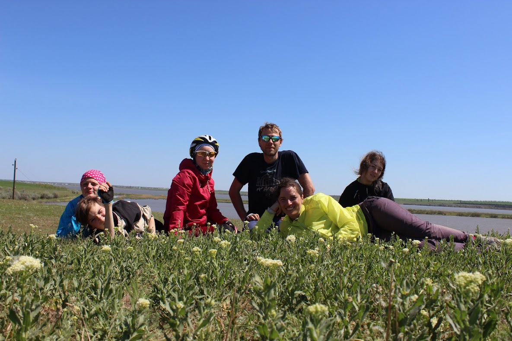
Просто на память себе и родным.

---

Я иногда жалуюсь. Иногда, наверное, сильно. В частности на то, что из-за нашего быта и достижения каких-то несомнено благородных целей, мы блекло проживаем жизнь. А ведь могли бы весь шар земной обойти! А вместо этого надо на почту заскочить на обеденом перерыве или помидоры купить, потому что закончились.
Несомнено, каждый день есть маленькие "развлекушки" типа сладенького, книжки/сериальчика перед сном или велопрогулки по Трассе Здоровья, но хочется более глобальных вещей. Но недавно задумался и понял: я достаточно интересно живу, зря жалуюсь, по крайней мере за последние полгода так уж точно.

- [Четыре дня в Киеве](#kiev)
- [Первый отпуск в санатории](#sanatorium)
- [C++ конференция в Минске](#corehard_spring)
- [Старт стройки дома](#building)
- [Велопоход по Южной Бессарабии, первое руководство](#bike_trip)
- [Сасык](#Sasyk_Lagoon)
- [Свадьба](#wedding)
- [Водный поход Турунчук-Днестр-Днестровский лиман](#water_trip)

## Четыре дня в Киеве   {#kiev}

Ане нужно было мотнуться по работе, а я за компанию. Всего было 4ре дня: с субботы по вторник. В выходные много гуляли днем, по вечерам в театрах. Старались кушать в кафе/ресторанах с той или иной национальной кухней(грузинская, японская, узбецкая, украинская и так далее). В будние каждый был занят своим: Аня на тренинге, я готовил доклад к предстоящей [конференции](#corehard_spring) по С++ в Минске. Такой себе трудо-гастро-культный туризм.

    

        
        
  

        
        
  

        
  

    

    <!-- Bullet Navigator -->
    
 

 

    <!-- Arrow Navigator -->
    
    

Гидропорт

В первый день прогулок, недалеко от Площади Независимости, нашли очень хороший кофе, который Ане сильно понравился. За ним и ходили все последующее время:
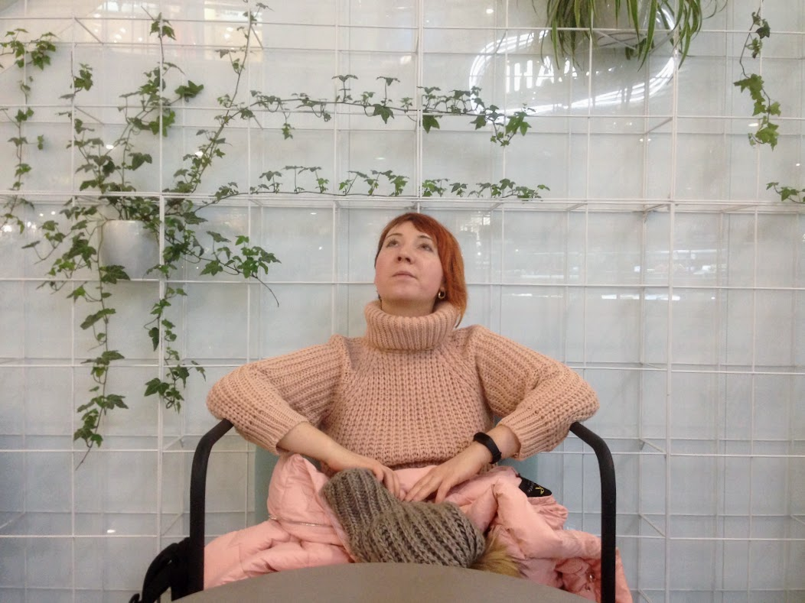
В ожидании "самого лучшего кофе"

Были на представлении "VIЙ 2.0." от (Дикого театра)[http://wild-t.com.ua/]. Я дико их рекомендую, если для вас не страшна уместная нецензурная лексика.

    

        
        
  

        
        
  

    

    <!-- Bullet Navigator -->
    
 

 

    <!-- Arrow Navigator -->
    
    

А вот на балете в Национальной опере мне жутко не понравилось.

Еще почти случайно наткнулись на музей 

    

        
        
  

        
        
  

    

    <!-- Bullet Navigator -->
    
 

 

    <!-- Arrow Navigator -->
    
    

Музей Булгакова

Зомби:
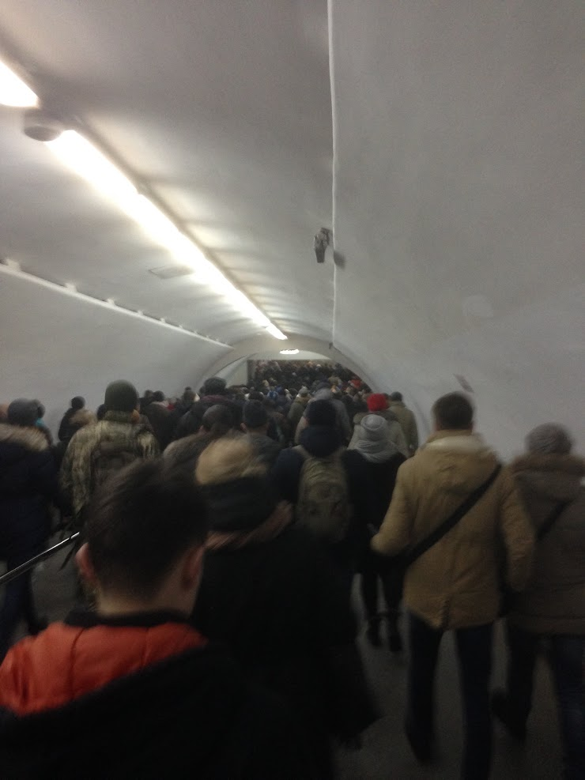

## Санаторий {#sanatorium}

    

        
        
  

        
        
  

        
  

        
  

        
  

    

    <!-- Bullet Navigator -->
    
 

 

    <!-- Arrow Navigator -->
    
    

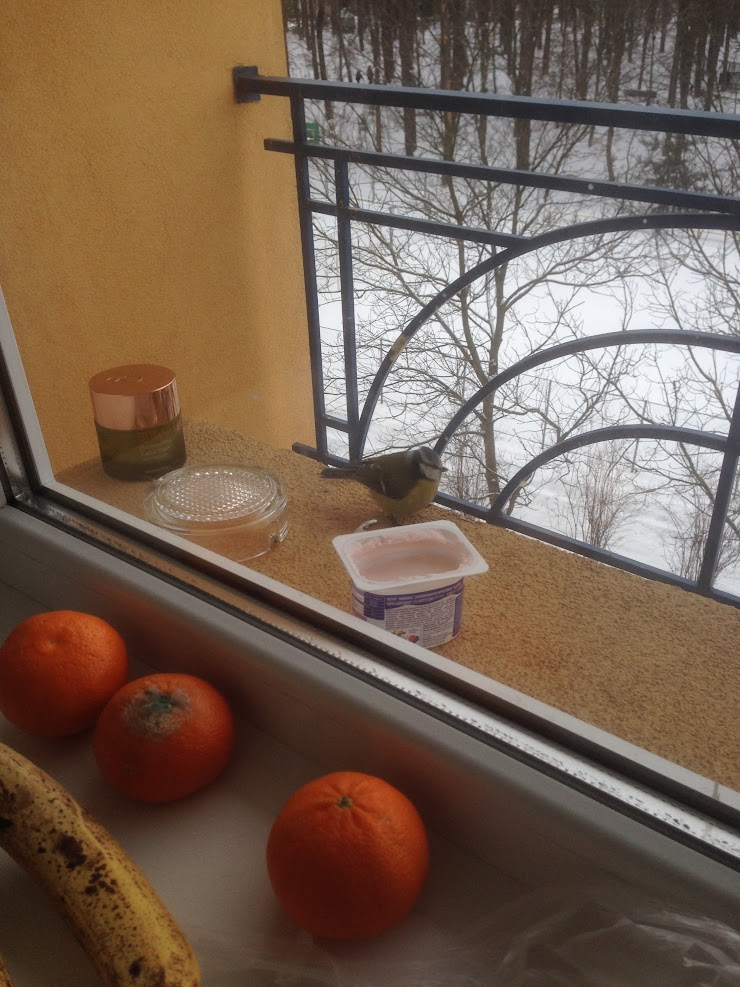

В размеренности процедур и питании по рассписанию есть какой-то свой кайф. Оздоровительный праздник души и тела

## C++ конференция в Минске {#corehard_spring}
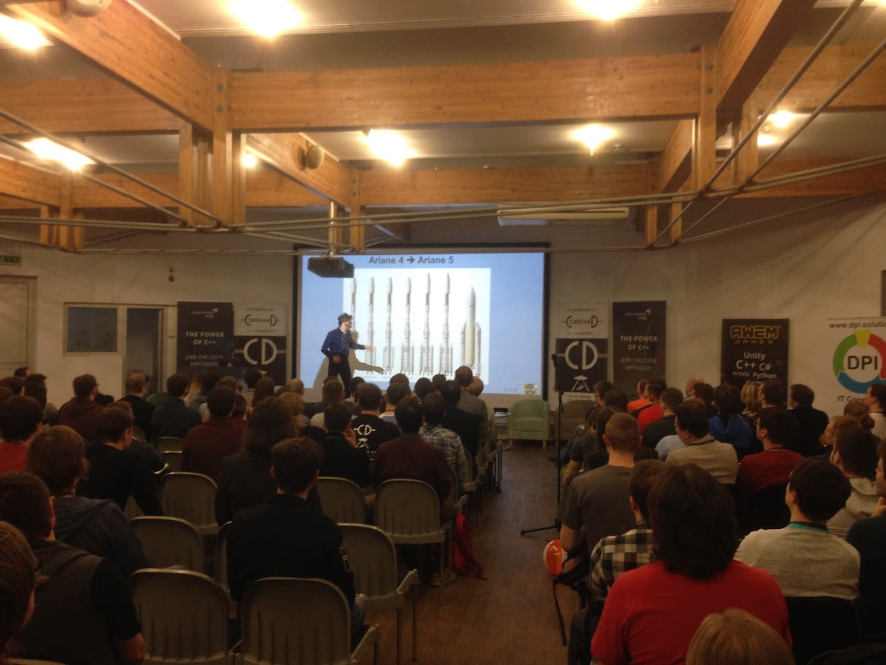
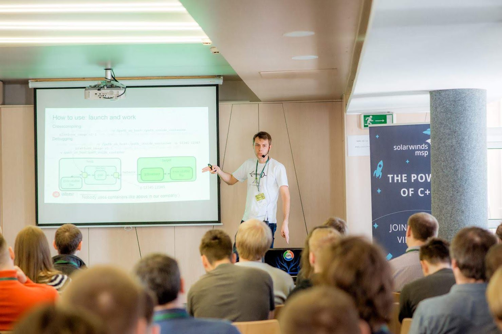

## Старт стройки дома   {#building}
В конце апреля стартовали работы по постройке семейного дома. Вещь глобальнее некуда:). Не могу сказать что это событие попадает под категорию "развлекушек", но увлекательно. И чем дальше, тем больше. Хотя еще год назад было страшно до усрачки.
Подготовка к этому событию началась больше года назад.

    

        
        
  

        
        
  

        
  

        
  

        
  

        
        
  

        
        
  

        
        
  

        
        
  

        
        
  

        
        
  

    

    <!-- Bullet Navigator -->
    
 

 

    <!-- Arrow Navigator -->
    
    

## Велопоход по Южной Бессарабии, первое руководство    {#bike_trip}

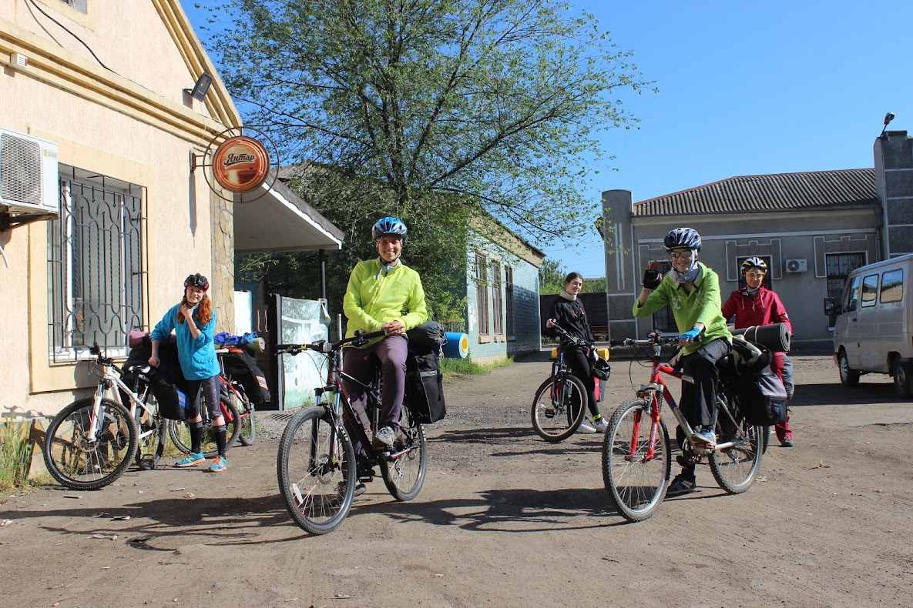
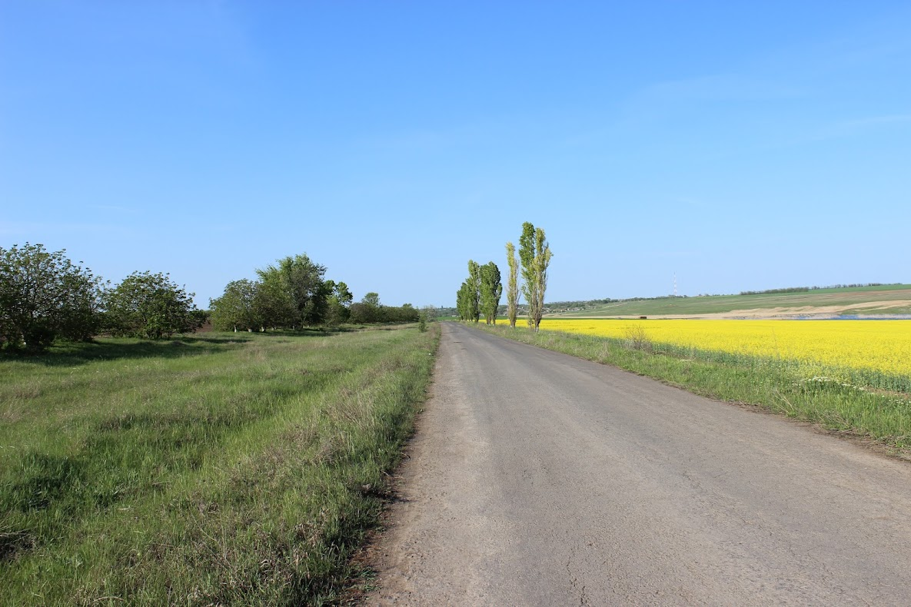

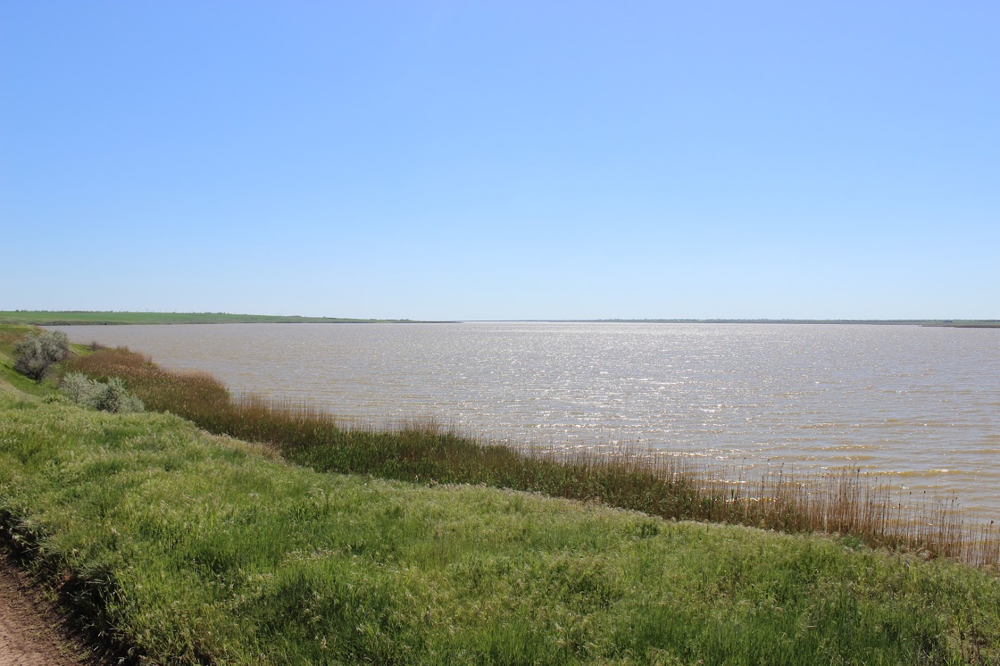
[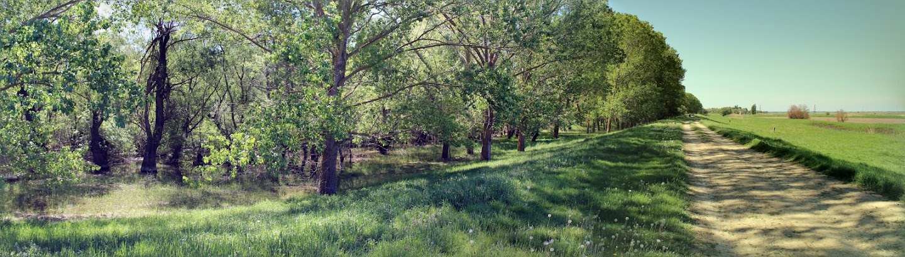](/assets/half-year-resume-2018/34.jpg)
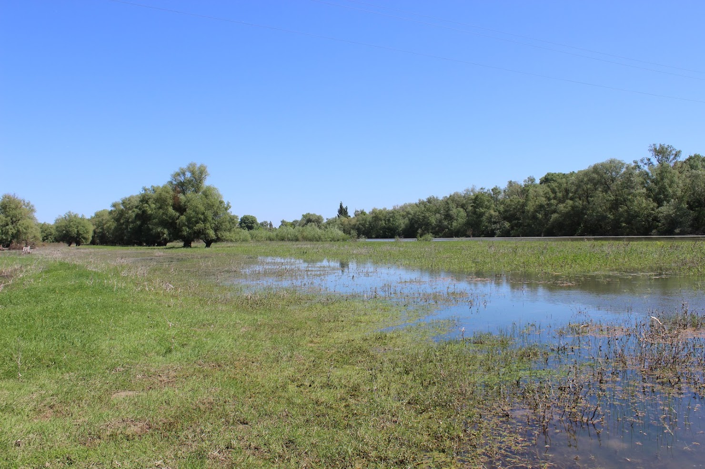
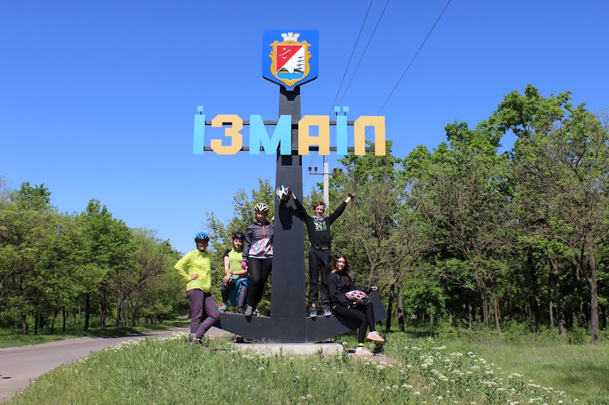

<iframe class="gpsies" src="//www.gpsies.com/mapOnly.do?fileId=qmspivhxdbinjpts" width="720" height="480" frameborder="0" scrolling="yes" marginheight="0" marginwidth="0"></iframe>
Маршрут

Основная концепция движения: вдоль озера Китай с выходом к Дунаю, после паралельное движение против течения реки в сторону Измаила.
Даты: 28.04.2018 - 01.05.2018.

В общем и целом поход прошел успешно. Травм или каких-то явных проблем не было, питание(слава завхозу!) было на высоте, окружающие виды интересные.

Слегка был тяжелый первый день: ранний подъем на поезд в 3 часа ночи(поезд Одесса-Измаил, выход в г. Арциз) и последующий достаточно длинный ходовой день(была цель выехать к о. Китай, чтобы встать там лагерем); большую часть дня было движение против ветра.

Последующие дни были более расслабленные в плане километража и с более красочной картинкой окружающего мира.
Следует учитывать что регион достаточно засушливый, во многих селах нет центрального водопровода, а вода из колодцев не всегда хорошего качества. Например, когда мы были в с. Васильевка, то столкнулись с ситуацией что вода практически закончилась, а набрать не было где. В итоге разжились живительной влагой у местных, которые сами ее собирают во время дождя с крыш, либо заказывают водовозами с соседних сел.
После выхода к Дунаю скорость продвижения значительно замедлилась - хотелось побольше времени провести среди такой красоты; мы устроили что-то вроде полудневки.
Примечательность большей части маршрута в том что это полудикие места, дороги очень плохие(там где есть асфальт, а его очень мало), либо вообще грунтовые. А это значит что автомобильного трафика очень и очень мало. Очень много птиц, все буяет зеленью. Маршрут не очень “волнистый”, в основном ровная дорога, на велосипеде катиться хорошо. 

Последние 10 км маршрута(от села Кислица) по направлению в Измаил идут по неплохому асфальту, через ряд сел. В самом Измаиле, после завершения маршрута, была культурная программа, посетили:
 - Диорама “Штурм крепости Измаил”
 - Музей миниатюр
 - просто вкусно покушали с красивым видом на набережную

## [Сасык](https://ru.wikipedia.org/wiki/%D0%A1%D0%B0%D1%81%D0%B8%D0%BA)    {#Sasyk_Lagoon}
Поездка-медитация. Бесконечный чистый и безлюдный пляж для тебя и родных.
[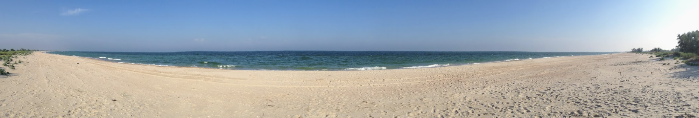](/assets/half-year-resume-2018/37.jpg)
Четыре дня вдали от городской суеты. Море, еда, сон и так по кругу.

## Свадьба  {#wedding}
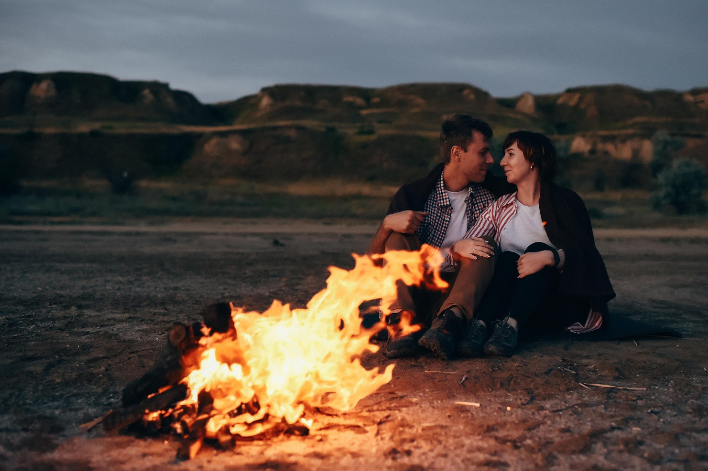
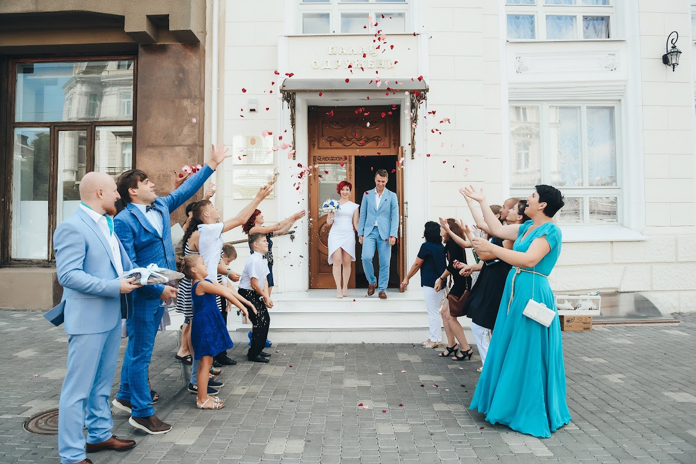
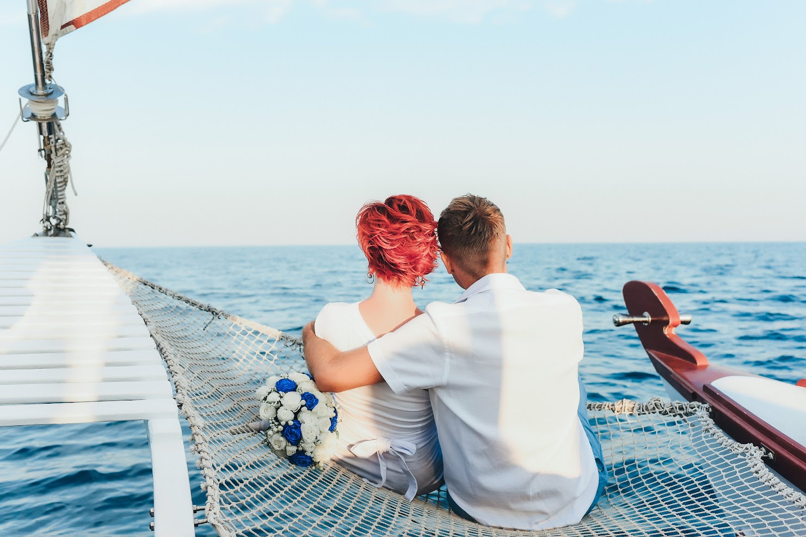

## Водный поход Турунчук-Днестр-Днестровский лиман  {#water_trip}

<iframe class="gpsies" src="//www.gpsies.com/mapOnly.do?fileId=uorokrogvhkioduy" width="720" height="540" frameborder="0" scrolling="yes" marginheight="0" marginwidth="0"></iframe>

    

        
        
  

        
        
  

        
  

        
  

    

    <!-- Bullet Navigator -->
    
 

 

    <!-- Arrow Navigator -->
    
    

