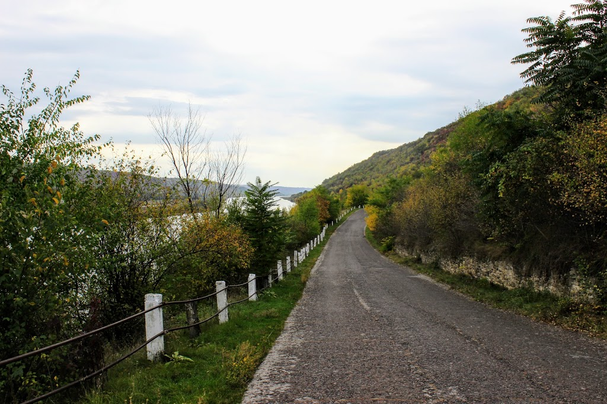
Бессмысленно и беспощадно.

---

По всем моим внутренним критериям и параметрам поход получился неудачным. Не было уверенности быть ли ему вообще, так как погода в Одессе уже была истинно осеняя: прилично похолодало, шли дожди, солнца давно не было видно, прогноз погоды на даты похода был неутешительный. На свободные 4-ре дня(13.10.2017 - 16.10.2017) маршрут я задумал приличный:
<iframe src="//www.gpsies.com/mapOnly.do?fileId=ikslqxyosxyehmma" width="720" height="480" frameborder="0" scrolling="no" marginheight="0" marginwidth="0"></iframe>
Почти 350 км по холмистым грунтам. Думал так: я ж еще молодой, <s><a href="https://youtu.be/U8HRQg-NPaQ?t=65">я ж еще страдаю ерунд...</a></s>, я ж "тренировался" до похода, катаясь из дома на работу и обратно на велосипеде, так что по 90 км на день для меня будет вообще фигня:).

На деле же получилось совсем не так как хотелось: пасмурная погода, сильный ветер, дождь в первый день, размокшие грунтовые дороги и разболевшееся колено меня сильно "подставили":). Впрочем, о всем по порядку.
<iframe src="//www.gpsies.com/mapOnly.do?fileId=fczkvqtqbulmfjqk" width="720" height="480" frameborder="0" scrolling="no" marginheight="0" marginwidth="0"></iframe>

Фактический маршрут

Концепция похода: проехать Молдову с севера на юг и завершить путешествие в Украине, с. [Старокозачье](https://ru.wikipedia.org/wiki/Староказачье), что на границе с Молдовой, откуда я родом и где живут мои родители.

При планировании маршрута смотрел на удобный подъезд к старту. Электричка Одесса - Вапнярка подходила идеально: удобно сразу после работы выехать, время на дорогу относительно небольшое, не надо заморачиваться с билетами. Прибежав с работы, я быстро что-то закинул в желудок, схватил велосипед со спакованным рюкзаком, быстро добрался до жд-вокзала и упаковался в электричку. "Упаковался" - именно то слово, которое здесь уместно. Я почему-то рассчитывал на малолюдность(вечер четверга же!), свободное пространство внутри вагона, где можно будет спокойно разместиться с велосипедом. Но не тут-то было! Все вагоны были сверху донизу забиты людьми и товарными коробками, причем последних едва ли было меньше чем людей. Я слегка опешил от такого расклада. Электричку только недавно подали, а она уже забита! Пока я в тамбуре снимал велобаул с багажника и откручивал педали(дабы они не цеплялись за людей и вещи), параллельно обдумывая куда приткнуться, вид двух внезапно начавших драться и материть друг друга женщин - за свободное место и "неправильно" лежащие коробки - меня просто убедил подождать несколько часов в тамбуре:).

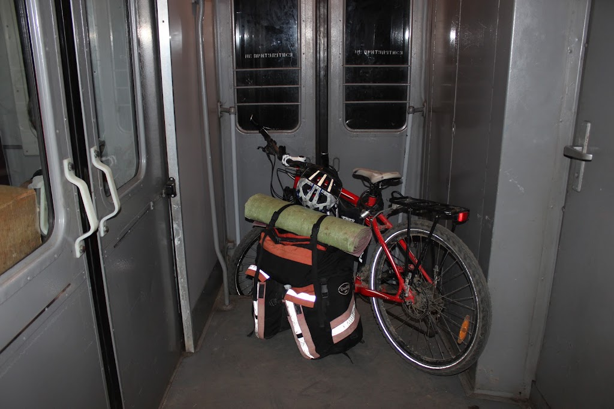
Я и друг мой <s><a href="https://ru.wikipedia.org/wiki/%D0%98_%D0%94%D1%80%D1%83%D0%B3_%D0%9C%D0%BE%D0%B9_%D0%93%D1%80%D1%83%D0%B7%D0%BE%D0%B2%D0%B8%D0%BA">грузовик</a></s> велосипед

В общем так или иначе в часов 10-ть ночи доехав до с. [Слободка](https://ru.wikipedia.org/wiki/%D0%A1%D0%BB%D0%BE%D0%B1%D0%BE%D0%B4%D0%BA%D0%B0_(%D0%9E%D0%B4%D0%B5%D1%81%D1%81%D0%BA%D0%B0%D1%8F_%D0%BE%D0%B1%D0%BB%D0%B0%D1%81%D1%82%D1%8C)), быстро выгрузился с электрички и вырулив за село на пару километров, я заночевал в придорожной лесополосе.
Утром проснулся, быстро позавтракал и выдвинулся.
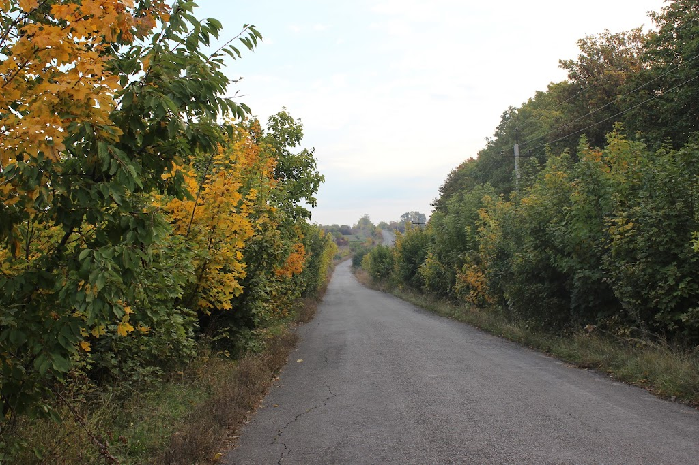
Красивая осенняя дорога на старте, еще Украина

Первые 35 км ничего особенного не было: таможня Украина-Приднестровье, неплохая асфальтовая дорога через деревни и поля, ветер и пасмурная погода. Собсно для меня все интересное начиналось после города [Рыбница](https://ru.wikipedia.org/wiki/%D0%A0%D1%8B%D0%B1%D0%BD%D0%B8%D1%86%D0%B0). К слову, когда в интернете читал за Приднестровье, то очень часто встречал фразу типа "вы попадете в СССР". Я же ничего такого не заметил. Весь мир глобален и развивается более-менее однородно. Села плюс-минус похожи друг на друга: бессарабские, пошарпанные.

    

        
  

        
        
  

        
        
  

        
        
  

    

    <!-- Bullet Navigator -->
    
 

 

    <!-- Arrow Navigator -->
    
    

Кадры, сделанные в селах Приднестровья, Молдовы и Украины, есть ли большая разница, где чье?

С городами тоже самое. Рыбница и Бендеры, вполне себе промышленные города, выглядят как типичные Белгород-Днестровский или Новая Каховка. Что там, что там есть много заводов, которые стоят или как-то работают, панельные дома, рекламные борды, кафе и полу разбитый асфальт(хотя, признаюсь, дороги по Приднестровью, там где я бывал, приятные).

    

        
  

        
        
  

        
        
  

    

    <!-- Bullet Navigator -->
    
 

 

    <!-- Arrow Navigator -->
    
    

На центральной площади Рыбницы, промзона Бендер

Впрочем, я слегка отошел от основного повествования. В Рыбнице быстро прошел таможню  Приднестровье/Молдова, ...
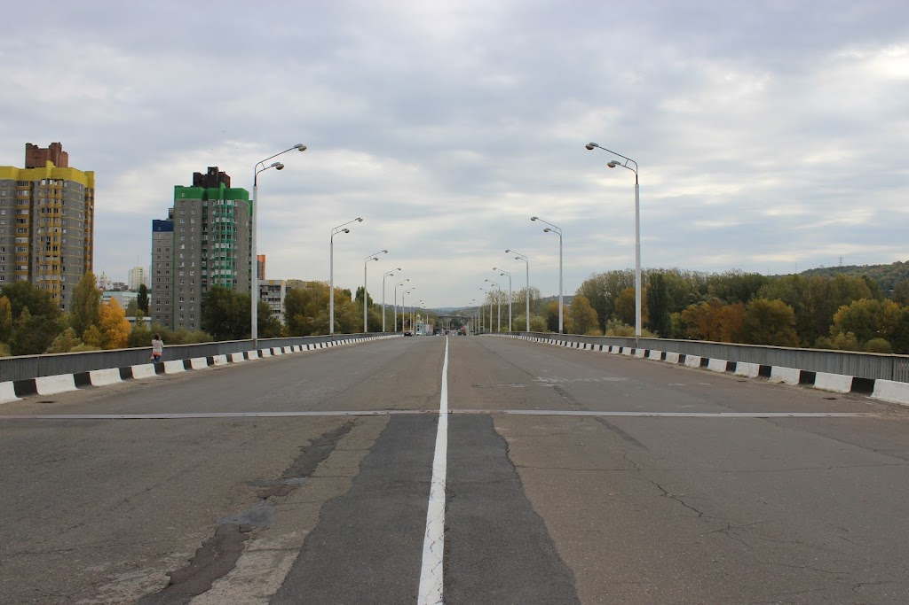
Мост между Приднестровьем и Молдовой, вид в сторону Рыбницы

...переехал через Днестр и началось для меня то, ради чего ехал в поход: дорога вдоль Днестра, красивая и живописная, по осеннему желто-зелено-красная. Заглавное фото как раз сделано в начале этой дороги. Дорога сначала была покрыта сносным асфальтом, петляла по селам, ехалось легко. Достаточно быстро доехал к первой точке, куда я стремился - водопад в с. [Сахарна](https://ru.wikipedia.org/wiki/%D0%A1%D0%B0%D1%85%D0%B0%D1%80%D0%BD%D0%B0).

    

        
  

        
        
  

        
        
  

    

    <!-- Bullet Navigator -->
    
 

 

    <!-- Arrow Navigator -->
    
    

Водопад и монастырь в Сахарне

Там же и пообедал, слушая шум воды и служений в монастыре.

Продолжил путь. Как только покинул Сахарну, начался жестяк: асфальт внезапно и бесповоротно исчез, грунтовка круто взлетела вверх и начала уходить в сторону от Днестра, небо затянуло свинцом, начал слегка моросить дождь и по мере подъема усиливался ветер.

Я был в курсе что мне предстоит ехать через полевые дороги. Там собсно других путей и нет. И я очень расчитывал, что я их проскочу "насухо". Не повезло:).

Сначала были дороги внутри лесополос:

    

        
  

        
        
  

        
        
  

    

    <!-- Bullet Navigator -->
    
 

 

    <!-- Arrow Navigator -->
    
    

Вы вот смотрите на фото и возможно думаете: "Как красиво, я бы тоже хотел(а) там прокатится". Но ... оно то, конечно, красиво, но блин тяжело. Кадры были сделаны, когда было легко и приятно ехать. Когда же было <s>говнище</s> болотище, мне было не до фоток

Было красиво и тяжело: не всегда можно было ехать из-за болота и больших колей от тракторов, ветки деревьев и шиповника хлестали по рукам, лезли в спицы и цепь велосипеда. Но был один жирный плюс: растительные коридоры реально хорошо защищали от ветра, минус одна стихия, с которой надо бороться.

Вообще был альтернативный путь, грейдер, по которому местные ездят друг к другу. Без зарослей и преодолевания себя. Но он делал крюк, плюс не <s>интересный</s> живописный. В общем, пару часов я провел, интересно пробираясь через дебри. После того как выбрался на просто накатанные грунты, зарядил уже полноценный дождь. Видимо для того чтобы стало совсем интересно. И, действительно, было очень увлекательно: с козырька шлема течет, холодная ветровка липнет к телу, дороги скользкие и неровные.
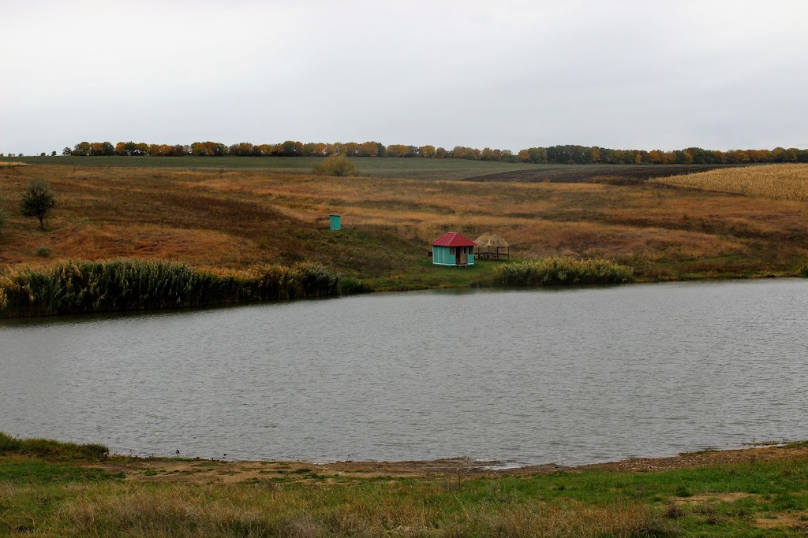
Яркий домик посреди серых полей

По плану я должен был доехать до с. [Цыпово](https://ru.wikipedia.org/wiki/%D0%A6%D1%8B%D0%BF%D0%BE%D0%B2%D0%BE). Именно в Цыпово хотелось заночевать, потому что там куча интересных местяков, как раз за пару часов вечером и утром можно было осмотреть. По gps, напрямую, расстояние было не больше 5 км, вообще фигня. Но дорога как-то обходила полукругом из-за цыповского ущелья. Я наконец-то выбрался с полей, ехал уже по грейдеру слегка в горку, дождь все также хлестал. В принципе я успевал осуществить задуманное: еще не было 17:00, до темноты, т.е. до 18:00 должен был бы успеть. Но у меня уже полностью промокли кроссовки. Велосипед потяжелел из-за болота, цепь начала характерно хрустеть от грязи. Начало слегка ныть колено. И я решил что ну его к черту мучиться. И в тот момент, когда я так подумал, недалеко от дороги увидел три больших шикарных дерева - грецких орехов. Я пулей туда залетел, за пару минут поставил палатку, запрыгнул туда вместе с велобаулом и быстро переоделся во второй комплект сухой одежды. Мне не было холодно, потому что все время вкручивал педали, но глупо же сидеть в мокрой одежде и остывать.

Дождь активно лил еще где-то с час. После того как он утих, я начал пытаться разжечь костер. Не получалось добрых минут 30-ть, так как все вокруг было пропитано влагой. Но главное не сдаваться:
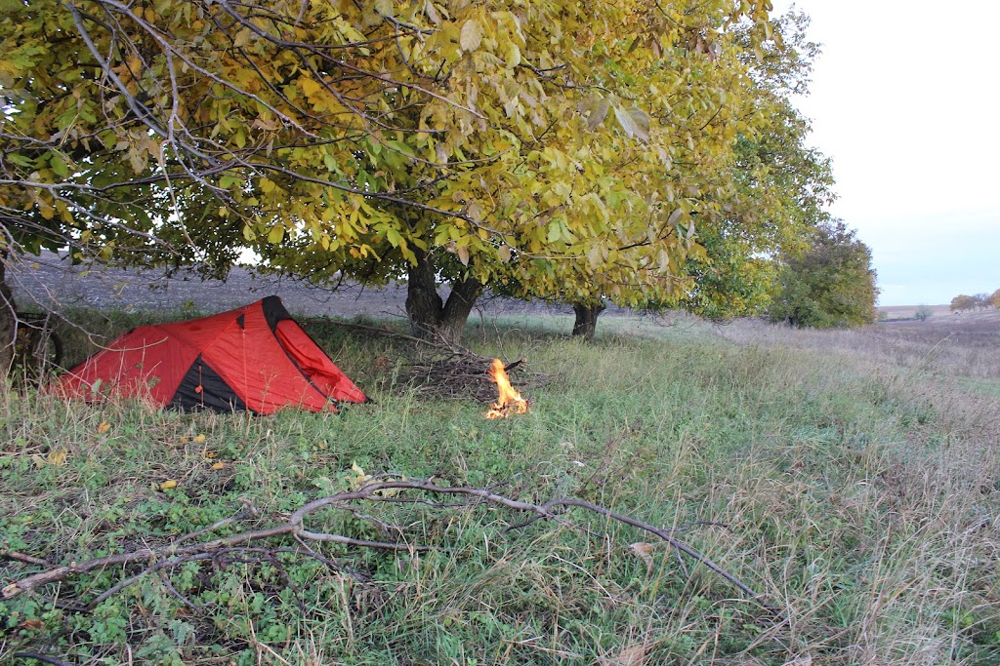
Когда полыхает костер, уют на бивуаке сразу повышается до небес. Можно со спокойной душой заняться приготовлением ужина, сушкой одежды, техобслуживанием велосипеда. Главное вовремя подкидывать дрова.

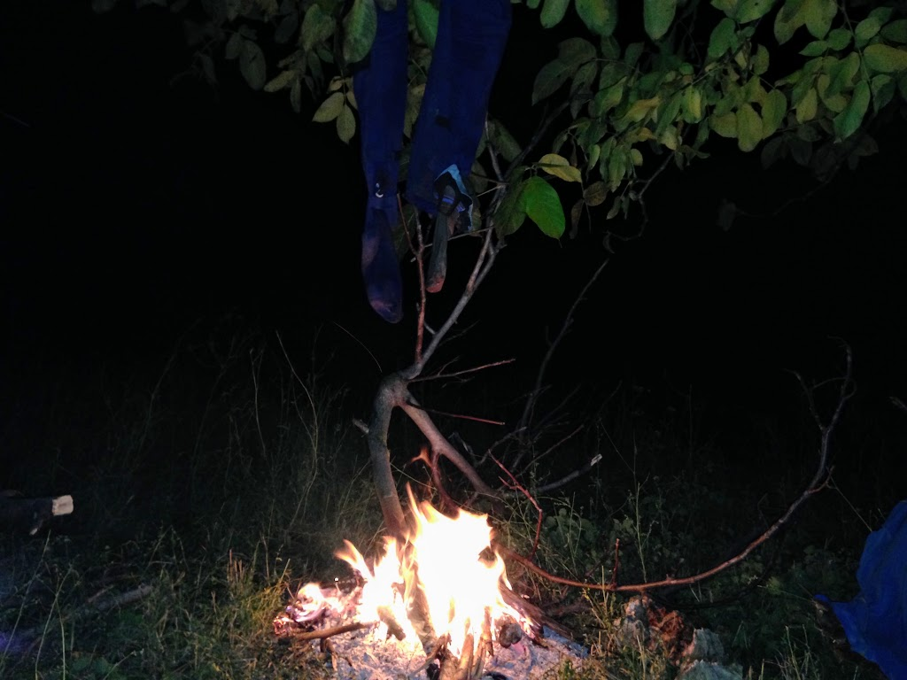
<s>Копчу</s> сушу мокрую одежду

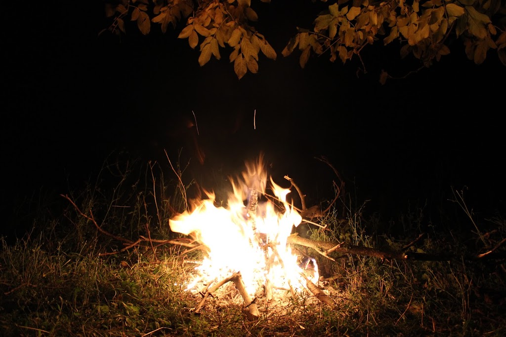
Интересно насколько это романтично: перекидываться с любимой смсками созерцая костер?:)

Cледующее утро было очень прохладным и мрачным, пронизывающий ветер абсолютно не стимулировал выползать из палатки. Потому я сидел до последнего в ней и вылез оттуда когда сделал все: приготовил еду на горелке, поел, переоделся в ходовую одежду, упаковал рюкзак. Внезапно, пока складывал палатку, выглянуло солнце:
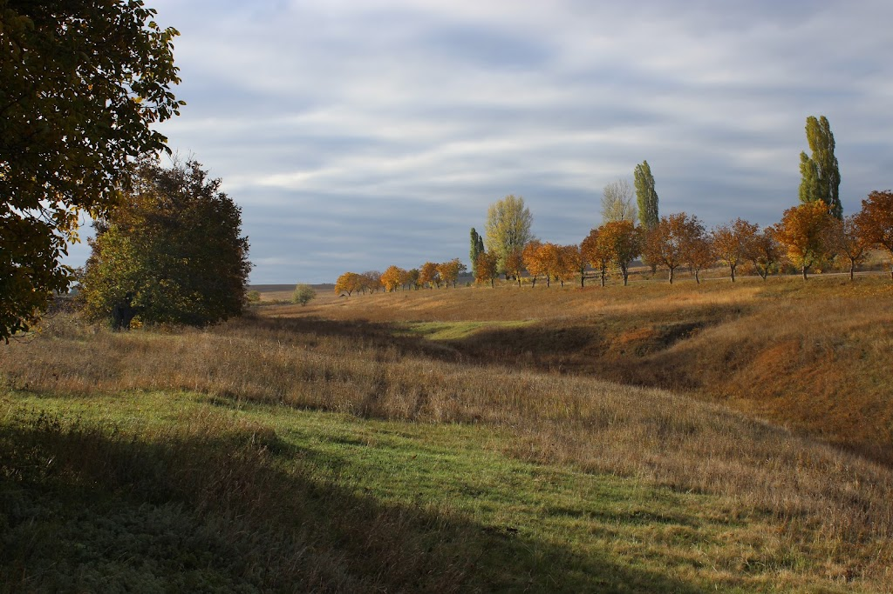
Правда спустя минуту оно исчезло. Но знак хороший.

До Цыпово я добрался сравнительно быстро:
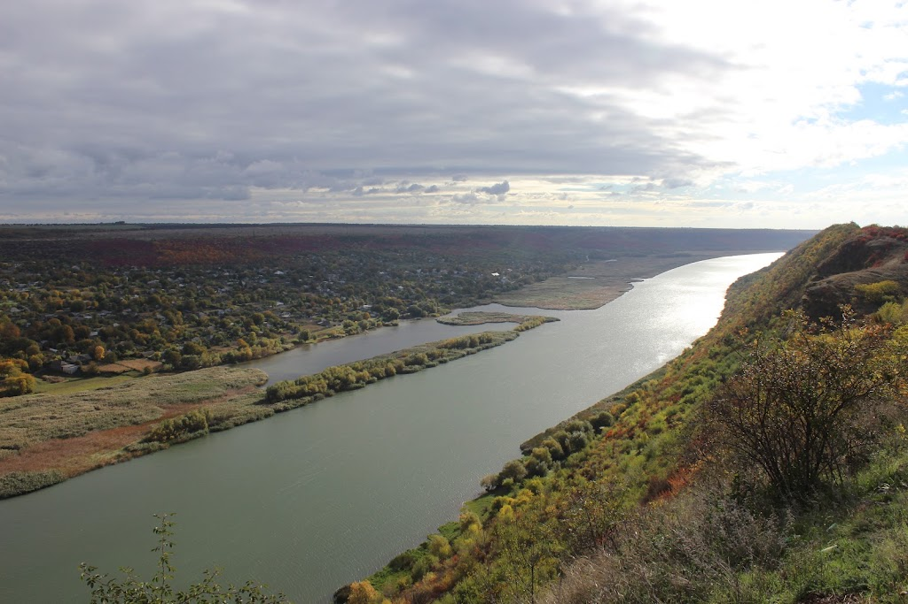
река Днестр
В ущелье рядом есть водопад подобный тому что я видел в Сахарне, потому я не стал тратить время на еще один подобный. Судя по [отчетам](http://mir-mak.livejournal.com/48221.html), которые читал в интернете, туда пешком шагать минимум час. Да и в принципе всю ту программу([старый скальный монастырь на берегу Днестра](https://ru-travel.livejournal.com/31974440.html), красивое ущелье), которую я планировал осуществить, пришлось забыть, так как я не смог добраться до Цыпово на ночевку. Маршрут у меня запланирован большой, а я вроде как "опаздываю". Потому ограничился просто красивым видом с обзорной площадки и 15-ти минутным отдыхом.
[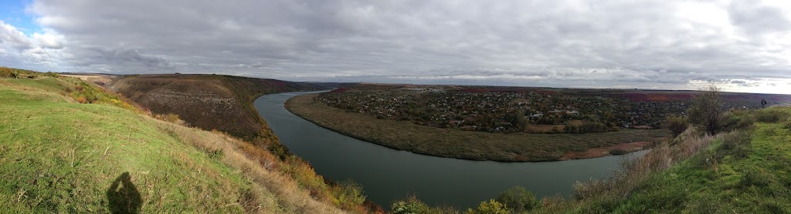](/assets/bike-moldova-october-2017/25.jpg)
Картина - класс, ветер тоже ... сильный

После Цыпово у меня в планах было добраться в [Старый Орхей](https://ru.wikipedia.org/wiki/%D0%A1%D1%82%D0%B0%D1%80%D1%8B%D0%B9_%D0%9E%D1%80%D1%85%D0%B5%D0%B9) посмотреть на красивые виды реки Реут, плюс скальные монастыри. И я еще был оптимистичен:). Путь туда - все те же грунтовки. В общем я опять намесил болота будь здоров. Очень медленно продвигался. Обедая в каком-то леске, я понял что тупо не успею таким темпом проехать все что запланировал. Потому просто выпрямил часть маршрута. Отменился Старый Орхей, Кишинев, таким образом исчезла петля почти в 100 км. К часам 4-м дня я наконец-то выбрался на хороший асфальт, который все время шел на юг, на Дуббосары и Тирасполь:
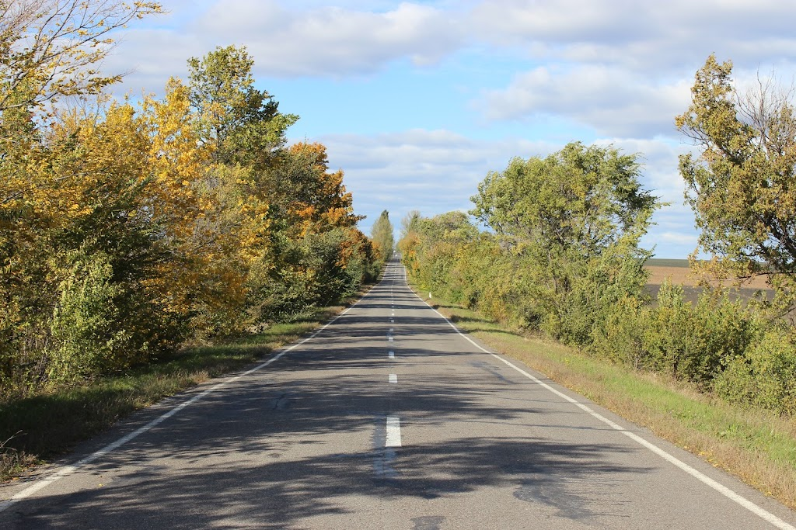
Слоган этого похода: "Нельзя просто так ехать и наслаждаться!". Если нет болотистых грунтовок, есть ветер. Если ветер твой помощник и асфальт шикарен, то колено объявит независимость:). Вот такие мысли у меня витали в голове, когда я маслал по трассе. И еще: "Ветер - враг мой, ветер - друг мой". Мое направление движения по асфальту, на который я выехал, идеально совпадало с направлением ветра. Так что практически всегда было хорошо. Но иногда дорога поворачивала так, что ветер был в лобовую. Ну а колено... Я на радостях(ровная и чистая дорога с попутным ветром!) взял быстрый темп. В правом колене возникло уже знакомое легкое ноющее ощущение. С таким ехать можно, главное не перегрузить колено, следить за ним, т.е. снизить обороты и больше "грузить" здоровое. В идеале, конечно, перейти вообще на контактные педали.

Проезжая через села, отмечал различные забавные штуки:
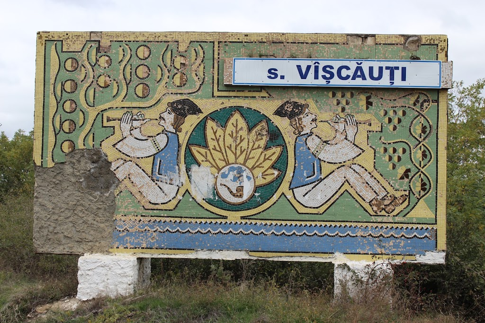
Пролетая на всех парах мимо этого я аж приафигел, развернулся назад, дабы более подробно рассмотреть:
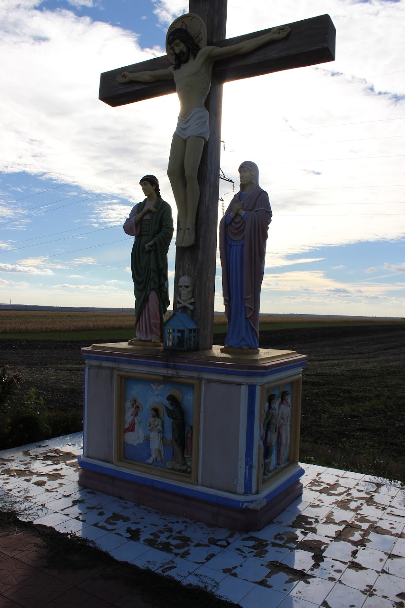
Я не верующий, потому нифига не понял что делает череп с костями на православном кресте. Уже потом в интернете вычитал: "Череп - это образ черепа Адама, на который, по преданию Святой Церкви, пролилась Кровь непорочного Агнца - который есть Иисус Христос, Сын Божий. Череп - это мы с вами, смертные. Дети Адама. Благодаря Жертве на Кресте, Кровь омыла нашу падшую природу, дав каждому из нас Дорогу в Царство Иисуса Христа. Царство Небесное. Рай." Ну ок, понятно, но жутковато.
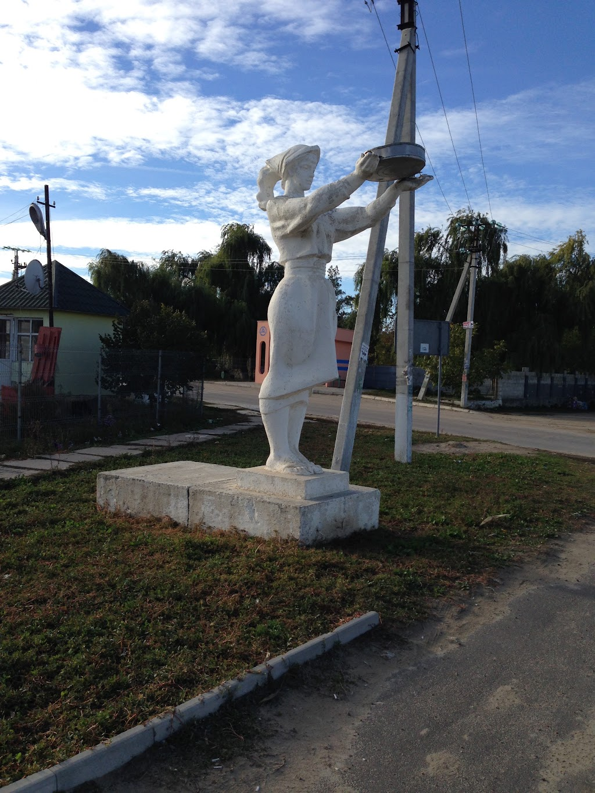
с. Устия, недалеко от моста на Дуббосары
К слову, такие артефакты попадались в молдавских селах, в Приднестровье такого я не видел.

Еще меня радовало большое количество колодцев, проблем с водой вообще не было:

    

        
  

        
        
  

        
        
  

    

    <!-- Bullet Navigator -->
    
 

 

    <!-- Arrow Navigator -->
    
    

Они настолько часто попадались, что даже когда у меня оставалось критично мало воды, мне лень было останавливаться дабы пополнить запасы, потому что я знал что впереди по любому будет еще один колодец.

Дальше основная дорога разветвлялась. Одно из направлений уходило в сторону Кишинева, куда я уже не собирался ехать. Второе направление перескакивало через Днестр и шло прямо на Тирасполь. Туда я и поехал. На мосту ко мне прицепились какие-то агрессивные дворняги, не просто лаяли, а аж за штанину пару раз хватали. Удар ноги в голову не помогал, наоборот их делал более агрессивными. Тогда я резко ускорился, дабы оторваться. Получилось, но зря я это сделал. Понял сие когда спешился перед погранпостом Молдова/Приднестровье - начало резко болеть колено. После прохождения всех формальностей я не поехал, а пошкандыбал. Где-то через полчаса я остановился на ночевку в леске на крутом склоне над Днестром:
[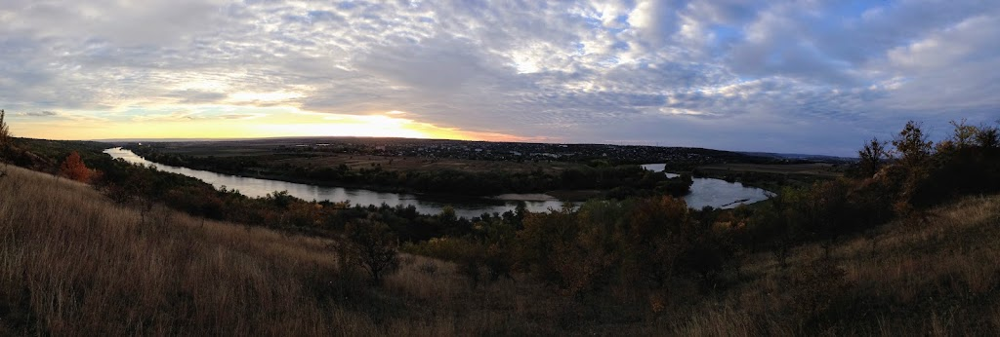](/assets/bike-moldova-october-2017/34.jpg)
Шикарный вид
За второй ходовой день опять проехал где-то с 60 км. Мало. Но даже с таким километражом я успею добраться до финиша по сокращенному варианту маршрута за следующие два дня. С такой мыслью я уснул.

На следующий, третий день, проехав буквально километров 10-ть, я понял что правое колено отказало совсем. Перестал мучить колено, пошел пешком. Если идти я хоть как-то могу, то тупо сгибать-разгибать, даже не давить на педаль, было адски больно. Я слегка приуныл. Что ж, блин, такое?! Все время то дождь, то ветер в лобовую, то пасмурно. Я рассчитывал совсем на другое:). Где ж тут удовольствие получить? До конечного пункта чуть больше 100 км, при чем уже по равнине, т.е. без горок. При нормальных обстоятельствах я и за день такое расстояние проеду. А в запасе было два: сегодня и завтра. Но с таким раскладом я уже потерял запал, да и не было физической возможности ехать.

Прочапав минут 15-ть, я полностью осознал, что велопоход для меня окончен. Ну раз так, то надо как-то домой добираться, причем желательно сегодня.

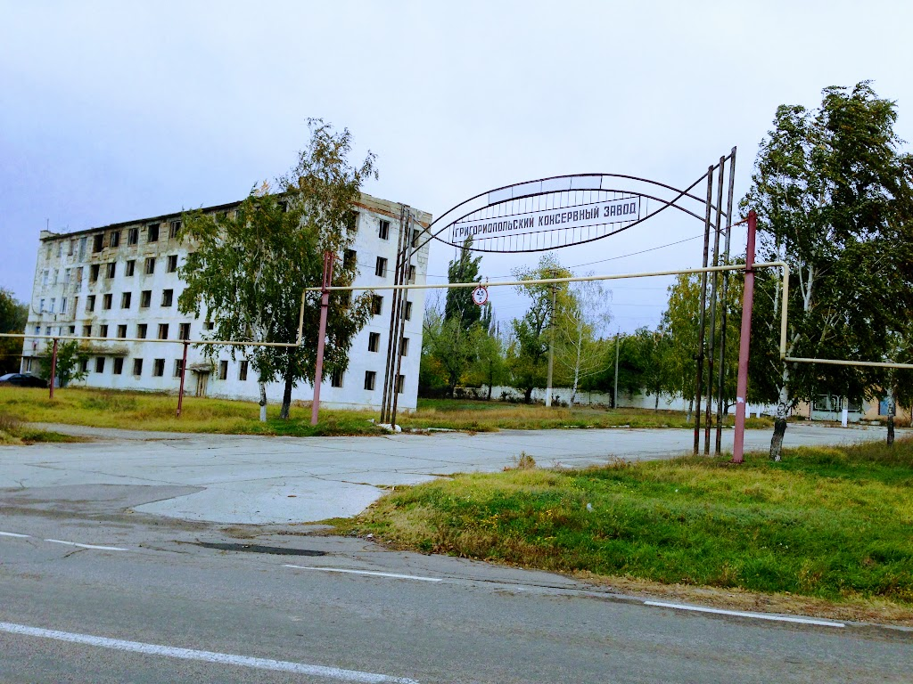
Размышляю что делать дальше, глядя на (заброшенный?) консервный завод в Григорополе

Как это сделать, находясь в Приднестровье, в каком-то [селе](https://ru.wikipedia.org/wiki/%D0%93%D1%80%D0%B8%D0%B3%D0%BE%D1%80%D0%B8%D0%BE%D0%BF%D0%BE%D0%BB%D1%8C), где транспортного сообщения-то особо нет? Автостоп! Автостоп в велосипедном походе - это что-то новое, такого у меня раньше еще не было:). Сотня километров для авто вообще дело плевое.

По понятным причинам я стопил только грузовые авто. Первая машина, которую застопил, была старая ГАЗ-53. И какая удача, водитель Виталий ехал аж в Бендеры, что уже покрывало большую часть пути. Оказалось что Виталий байкер, с его слов, потому и решил остановиться:

>Вижу велосипедист стоит, голосует. Дай, думаю, остановлюсь, может помощь какая нужна.

Пока ехали, весело перекрикивались, потому что иначе невозможно было общаться. Легче становилось, когда Виталий разгонялся, переключался на нейтральную передачу и дальше мы каких-то пару сотен метров ехали накатом в относительной "тишине" двигателя:).
<iframe width="720" height="405" src="https://www.youtube.com/embed/o0mPNtnT8Do?rel=0" frameborder="0" allowfullscreen></iframe>

В Бендерах мы попрощались, следующие километров 20-ть проехал-прошел. По прямой дороге и на спусках я крутил педаль одной ногой: из веревки на педали сделал себе лямку для ноги. Передачу пониже, вторая нога просто болтается и вперед! Забавно, наверное, со стороны выглядел. В горку и против ветра я, конечно, шел пешком. На очередном подьеме удалось застопить легковушку-пирожок. Они меня подкинули еще на 10-ку километров, почти к [Штефан-Водэ](https://ru.wikipedia.org/wiki/%D0%A8%D1%82%D0%B5%D1%84%D0%B0%D0%BD-%D0%92%D0%BE%D0%B4%D1%8D).

    

        
  

        
        
  

        
        
  

    

    <!-- Bullet Navigator -->
    
 

 

    <!-- Arrow Navigator -->
    
    

Хорошо идем! К финальной точке маршрута осталось каких-то 30-35 км! А еще только обед. И еще так удачно выпрямилась дорога и ненавистный до сих пор сильный ветер теперь все время дует в спину. Я даже с одной рабочей ногой мог особо не напрягаясь держать темп в 20-25 км/ч. Был забавный момент, когда я проезжал через какое-то село и там двигалась колона велосипедистов, несколько взрослых и много детей(что-то похожее на школьный велопоход). Я решил выпендриться и пошел на обгон. Естественно "одноногий" велосипедист с рюкзаком, который обгонял колону других велосипедистов вызвал фурор и желание погоняться:). Но к моему удивлению я легко их всех обошел и оторвался. 

Спустя несколько километров я устал и перед очередной пологой горкой спешился. Так я хромал себе с минут пять, когда передо мной остановился мужик на жигуле, мол "все ли нормально?". В итоге мы закинули велосипед на багажник на крыше авто и он меня подвез почти до таможенного поста. Осталось там каких-то 5 км, которые я без особого напряга доехал на одной ноге.

Быстро прошел молдавскую таможню, долго стоял на украинской(у них одно окошко на всех, очереди дикие!), после меня уже отец встретил на авто.

Резюмируя: поход получился совсем не таким как я его себе представлял. С точки зрения планирования - полный провал. Маршрут не тот что изначально наметил, многие интересные места не посетил, погода подкачала. С точки зрения приключений да и общего впечатления - ничего так:). Каждый день по своему соревновательный с чем-то. То с ветром и дождем, то с коленом, то азартное добирание домой автостопом. И еще одно: старею я, пора пересаживаться на мотоцикл:).

