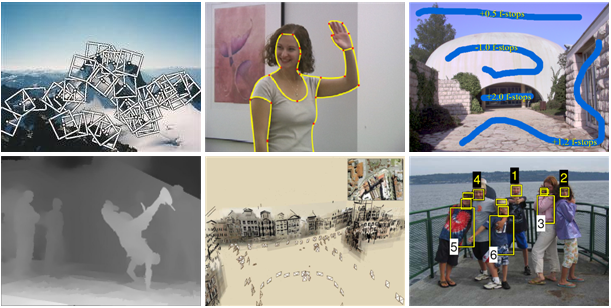

---

[Введение в компьютерное зрение - lektorium.tv](https://www.lektorium.tv/course/22847)

[Курс "Системы технического зрения" 2016](http://volokhov.blogspot.com/2016/02/2016.html), Автор: Владимир Волохов

[Компьютерное зрение и обработка изображений, мехмат ЮФУ](http://edu.mmcs.sfedu.ru/course/view.php?id=228)

[Машинное обучение - Курс ННГУ](http://www.uic.unn.ru/~zny/ml/)

[Практическое введение в компьютерное зрение - ИТ-Заметки](http://my-it-notes.com/2013/05/practical-computer-vision-introduction/)

[Computer Vision: Algorithms and Applications - Richard Szeliski](http://szeliski.org/Book/)
